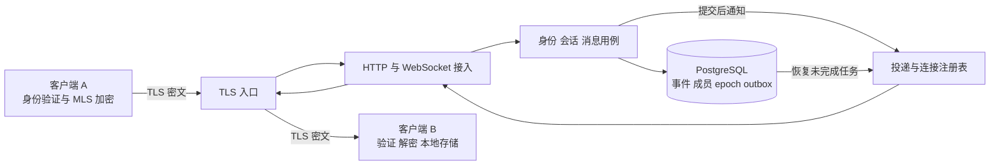

# LIM 系统架构

## 产品目标与首版边界

LIM 是以默认端到端加密和低延迟为核心的通用自托管 IM 服务器。部署单位是一个组织或个人实例；首版采用单实例、单进程模块化架构，生产部署以 Linux 为首个验收平台，macOS 用于开发验证。客户端通过公开协议接入，仓库需配套真实加密的协议测试客户端。

| 首版交付 | 后续扩展 |
| --- | --- |
| 邀请制账号、设备登记与撤销、会话认证 | 联邦、跨实例身份、开放注册 |
| 单聊、邀请制群聊、群角色与成员变更 | 超大群、频道、公开社区 |
| MLS 密文消息、多设备接收、断线补齐 | 加密附件、端侧搜索、用户控制的历史迁移 |
| 可选加密已读回执、连接状态、限流 | 音视频、移动推送、精细在线状态 |
| 可恢复存储、健康检查、指标、备份恢复 | 多实例路由、跨地域容灾 |

首版默认上限设为每账号 4 个活跃设备、每群 128 个账号且最多 512 个 MLS 设备成员、每账号 256 个活跃会话。它们是容量与滥用控制的配置默认值，实际容量通过压测确定。附件和音视频使用独立数据通道，后续接入时保持聊天热路径独立。

## 核心决策

| 决策 | 目的与约束 |
| --- | --- |
| 单进程模块化服务 | 以进程内调用完成首版业务，统一部署与关闭；按领域建立边界 |
| 默认 MLS 1.0 E2EE | 单聊和群聊使用统一设备成员模型，客户端管理群状态与密钥 |
| TLS 1.3 + WebSocket | 常驻双向连接承载消息，HTTP 处理登录、设备、目录与补齐 |
| PostgreSQL 18 基线 | 会话事件、epoch、成员关系与投递任务通过事务保持一致 |
| 提交后直推 + durable outbox | 常规消息立即进入连接队列，崩溃后由数据库任务恢复投递 |
| 每会话单调序号 | 将消息与加密控制事件放入同一有序日志，便于恢复 MLS 状态 |
| 同一消息至少一次投递 | 服务端幂等写入、客户端按事件键去重；断线可安全重试 |
| 按需使用 ltool | 复用 LWeb、LJson、LConfig、LLog；网络类型局限在适配层 |

保留现有 C++23 方向与 modules 入口。业务模块按职责划分，源文件形式在 M0 工具链验证后确定；业务逻辑无需全部导出为 C++ named modules。新依赖在引入时固定精确版本并记录许可，所有业务目标同步维护 CMake 与 xmake。

## 运行拓扑

默认部署为 TLS 反向代理、一个 `lim-server` 进程和一个 PostgreSQL 实例。代理到应用走同机 loopback；跨主机时同样使用 TLS。数据库只向服务端开放。生产配置要求外部入口 TLS、数据库持久化与认证可用，缺失时启动失败；开发明文模式仅绑定 loopback，并显式启用。

首版具有单进程故障域；重启由客户端重连和日志补齐恢复服务。后续多实例接入增加连接路由与跨节点通知，消息事实仍以数据库日志为准。

## 模块边界与依赖

下表是计划中的目录，随相应里程碑引入实际文件。当前只落地设计文档。

| 目录或目标 | 职责 | 允许依赖 |
| --- | --- | --- |
| `src/app/` · `lim-server` | 配置、对象组装、信号、启动和关闭 | 全部内部组件 |
| `src/domain/` · `lim-domain` | ID、成员权限、消息状态、限制和错误类型 | 标准库 |
| `src/application/` · `lim-application` | 发送、加密组变更、同步、设备撤销用例 | domain、其自身定义的存储与投递接口 |
| `src/transport/` · `lim-transport` | HTTP/WS 编解码、认证入口、限流、连接写队列 | application、LWeb/Cinatra、LJson |
| `src/storage/` · `lim-storage` | PostgreSQL 事务、查询、迁移、outbox | application 接口、libpq |
| `src/runtime/` · `lim-runtime` | 有界任务执行、连接注册、定时与指标 | application 接口、标准库及已有执行设施 |
| `tests/` | 领域、协议、数据库、真实 MLS 客户端集成和故障用例 | 被测目标 |

依赖通过构造函数显式注入，进程入口拥有组件。application 仅在外部边界定义必要接口，例如 `MessageStore::append_event`、`SyncStore::read_events`、`DeliverySink::notify_committed`。一个存储操作完成整个业务事务，禁止将事务拆成彼此独立的通用 CRUD 调用。内部结果统一为带 `ErrorCode` 的结果类型，具体承载类型在 M0 特性探针后固定。

网络请求对象、JSON DOM、数据库句柄均留在适配层。跨异步边界使用拥有数据的命令对象，领域代码接收标准值类型。`LWeb` 需要独立包含，现有 `import ltool` 未导出该组件；WebSocket 使用仓库内 Cinatra 原生能力的小型适配器，M0 先验证其并发写入、取消和退出行为。

## 消息热路径

1. 客户端先保存本地待发送消息与加密后的完整字节，再通过已认证连接发送；重试复用同一幂等键和密文。
2. 接入层检查帧长度、身份、配额与字段格式，将拥有型命令交给 application。
3. 数据库事务锁定会话记录，检查设备和成员权限、幂等记录、当前 epoch 与冻结状态。旧请求的已提交结果优先于 epoch 冲突返回。
4. 分配 `conversation_seq`，写入密文事件、幂等记录和 outbox；事务提交完成后返回 `accepted`。
5. 同一次提交完成回调立即唤醒投递组件。连接只由所属执行器上的写循环发送，热路径无定时批量等待。
6. 接收客户端按会话序号补齐、验证 MLS、解密并持久化状态；收到重复事件时复用已保存结果。

同一会话的发送、MLS Commit 和成员修改使用同一条数据库行作为串行化边界；不同会话独立推进。PostgreSQL 行锁持续到事务结束，可以据此约束并发顺序。[PostgreSQL 行锁](https://www.postgresql.org/docs/18/explicit-locking.html)

正常写入使用 `fsync=on`、`synchronous_commit=on`，确认成功的条件是本次提交满足部署的 WAL 持久化配置。单机磁盘失效的恢复能力由备份与复制策略决定。[PostgreSQL WAL 配置](https://www.postgresql.org/docs/18/runtime-config-wal.html)

## 实时投递与补齐

outbox 记录会话事件引用，不复制每个用户的消息正文。每个会话的投递任务由一个调度所有者推进，按序读取事件并向当前有权接收的在线设备投递，排除原发送连接。它同时校验事件的可见区间与设备当前状态。

提交后的内存通知是即时唤醒；进程启动扫描和低频恢复扫描负责找回通知遗漏。outbox 完成表示本次在线投递已尝试：离线设备、慢连接和写失败由持久化事件流补齐。投递前崩溃会重试，投递后标记前崩溃会产生重复。客户端在同一恢复代次内按 `(conversation_id, conversation_seq)` 去重，跨备份回退按[恢复代次契约](protocol.md#版本与基础类型)隔离。

同步分两层：账号目录变更流发现新增、移除的会话和设备授权变化；每会话事件流补齐密文和 Commit。普通发消息只写会话日志，避免在事务中为整个群逐人写收件箱。详见[同步契约](protocol.md#同步与游标)。

## 并发与资源所有权

- I/O 执行器负责连接和非阻塞网络操作。每条连接一个写循环，有序发送；业务线程只提交拥有型数据或共享不可变密文字节。
- 首版 libpq 操作运行在专用有界数据库线程池，每个工作线程独占连接；事务内不跨线程迁移 `PGconn`。libpq 要求同一连接避免并发使用。[libpq 线程约束](https://www.postgresql.org/docs/18/libpq-threading.html)
- 密码验证进入独立有界计算池，限制总内存和并发；它与消息 I/O、数据库池隔离。
- 数据库超时包括连接获取、锁等待、语句与事务截止时间。客户端超时后的提交状态可能未知，重试由幂等记录裁决。
- `Server` 持有长生命周期组件，连接注册表持有可取消会话。每个异步任务具有完成路径；跨挂起点的缓冲区保持所有权，不保存请求体的借用视图。
- 每连接和全局发送队列同时设置字节数与事件数上限。超限关闭慢连接并允许补齐，拒绝继续积压；控制事件与应用消息共用顺序规则。

## 启动 关闭与恢复

启动依次完成配置验证、数据库版本与 schema 检查、依赖构造、outbox 恢复、路由注册、监听和 readiness。迁移使用显式管理命令与数据库迁移锁，日常启动遇到不兼容 schema 时停止。

关闭时先撤销 readiness、停止新连接与新命令，再在截止时间内等待已受理事务结束、完成已提交事件的直推尝试、关闭连接、停止后台任务，最后释放线程池和数据库。超时关闭保留 outbox；异常退出同样通过数据库恢复。故障注入覆盖提交前后和网络确认前后。

## 运维与演进

日志记录请求关联、错误码与耗时，按[隐私策略](security.md#元数据与运维)处理身份字段。指标覆盖事件循环延迟、事务时间、锁等待、outbox 年龄、排队字节、重连和错误率。readiness 反映数据库、schema 与过载状态，liveness 反映进程调度存活。

先测量同会话锁竞争、数据库提交、群广播和客户端加密成本，再决定批量提交、非阻塞 libpq 或拆分网关。Redis、独立消息队列、分库分片均作为有实测瓶颈后的专项决策。引入任何优化时保留相同的持久化、鉴权和端到端加密契约。
